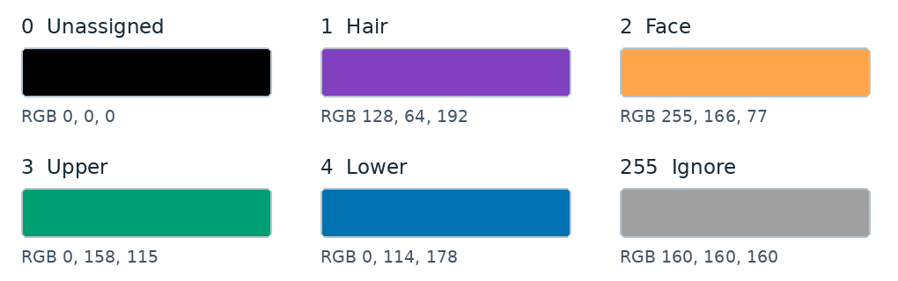

# ข้อกำหนด annotation ของ CCTV Human Parsing 600 Dataset

**Specification version 1.0.0**

เอกสารนี้กำหนดความหมายของป้ายกำกับ พิกัด ความสัมพันธ์ระหว่างส่วนกับบุคคล และวิธีตีความไฟล์ส่งมอบ ตัวเลข Label ID ใช้ตาม [labels.json](schema/labels.json) ส่วนโครงสร้างไฟล์ใช้ [JSON Schema](schema/annotation.schema.json)

ข้อมูลที่ตรวจล่าสุดเป็น **dataset revision 1.0.1-rc.1** ณ 17 พฤศจิกายน 2026 การแก้ครั้งนี้ใช้คลาสและ schema รุ่นเดิม สถิติและสถานะ QA ดูใน [README](README.md#6-ผลตรวจคุณภาพ) รุ่นตรวจสอบนี้แยก snapshot ออกจาก annotation ที่เปิดแก้ เพื่อผูกผลประเมินกับคำตอบชุดที่ใช้จริง



## 1. หน่วยข้อมูลและรหัสอ้างอิง

| หน่วย | รหัส | ความหมาย |
| --- | --- | --- |
| ภาพ | `image_id` ใน manifest | อ้างภาพหนึ่งรายการในชุดข้อมูล |
| บุคคล | `group_id` ของ bbox | จำนวนเต็มบวกที่แยกบุคคลภายในภาพเดียว |
| ประเภทวัตถุ | `category_id=1`, person | รหัสหมวดของกรอบบุคคลในงาน detection |
| คลาสของส่วน | Label IDs 1–4 | Hair, Face, Upper, Lower ตามลำดับ |
| พื้นที่ยกเว้น | Label ID 255 | Ignore region |
| พื้นที่ยังไม่มี target label | รหัสสำรอง 0 | Unassigned ใน derived semantic representation |

Class ID คงความหมายเหมือนกันทุกภาพ ส่วน person ID เริ่มนับใหม่ตามภาพ ตัวอย่างเช่น Hair ของคนที่ 2 มี `label="hair"` และ `group_id=2` การพบ `group_id=2` ในอีกภาพหนึ่งยังไม่มีข้อมูลยืนยันว่าเป็นคนเดียวกัน

Shape ของคลาสเดียวกันที่มีเจ้าของเดียวกันอาจมีหลายชิ้น เมื่อสร้าง binary mask ของคู่นั้นให้ใช้ union ของทุกชิ้น และคงรายละเอียดชิ้นที่แยกจากกันไว้

## 2. นิยามคลาส

### 2.1 Hair — Label ID 1

ผมบนศีรษะที่มองเห็นได้ รวมกลุ่มผมและปอยผมที่แยกจากฉากหลังได้จากพิกเซลต้นฉบับ ขอบเขตสิ้นสุดที่ขอบผมที่เห็นจริง

หมวก ผ้าคลุมศีรษะ หนวด และเคราอยู่นอกคลาสนี้ ส่วนผมที่ถูกหมวกหรือวัตถุบังให้เว้นตามที่บัง การวาดเส้นผมละเอียดต้องมีหลักฐานในภาพ หากความละเอียดภาพแยกเส้นไม่ได้ให้ยึดขอบกลุ่มผมที่มองเห็น

### 2.2 Face — Label ID 2

บริเวณใบหน้าที่มองเห็น รวมตา คิ้ว จมูก ปาก และหนวดเคราที่อยู่ภายในขอบใบหน้า นิยามนี้ใช้บริเวณใบหน้าโดยรวม จึงมีทั้งผิวและรายละเอียดใบหน้า

ขอบ Face แยกจากผม หู และคอ หน้ากากอนามัยหรือผ้าปิดหน้าที่ทึบให้เว้นส่วนที่ปิดบัง ใต้เลนส์ใสที่ยังเห็นใบหน้าสามารถเก็บบริเวณใบหน้าที่เห็นได้ ส่วนกรอบแว่น เลนส์ทึบ และบริเวณสะท้อนที่บังรายละเอียดให้แยกออกตามหลักฐานภาพ

การนำโมเดลที่มีคลาส Face_Neck มาใช้ต้องประกาศว่า prediction รวมคอ การแปลง hard label ที่รวม Face กับ Neck ให้เป็น face-only ต้องมีข้อมูลแยกส่วนเพิ่มเติม ชื่อคลาสใกล้เคียงกันเพียงอย่างเดียวยังรับรองความตรงกันของขอบเขตไม่ได้

### 2.3 Upper — Label ID 3

เสื้อผ้าส่วนบนที่สวมอยู่และมองเห็น ได้แก่ เสื้อยืด เสื้อเชิ้ต เสื้อแขนยาว เสื้อกั๊ก แจ็กเก็ต และเสื้อชั้นนอก ส่วนแขนเสื้อและชายเสื้อที่ต่อเนื่องกับเสื้อให้นับเป็น Upper ตามขอบเสื้อจริง

เมื่อมีหลายชั้น ให้เก็บแต่ละชั้นเฉพาะส่วนที่เปิดให้เห็น เช่น ปกเสื้อด้านในที่พ้นแจ็กเก็ต พื้นที่ผิวหนังที่เปิด กระเป๋า สายกระเป๋า สิ่งของที่ถือ และผ้าที่แยกได้ว่าเป็นวัตถุอื่นอยู่นอกคลาสนี้ การบังด้วยกระเป๋าหรือแขนให้คงช่องว่างที่เห็นตามภาพ

### 2.4 Lower — Label ID 4

เสื้อผ้าส่วนล่างที่มองเห็น ได้แก่ กางเกงขายาว กางเกงขาสั้น และกระโปรง ชิ้นส่วนแยกกันจากการบังหรือท่าทางให้มี person ID เดียวกับเจ้าของ

ผิวขา ถุงเท้า และรองเท้าอยู่นอกคลาสนี้ เมื่อเสื้อยาวปิดขอบกางเกงให้วาดเฉพาะส่วนกางเกงที่เห็น การเชื่อมผ่านบริเวณที่ถูกบังต้องเว้นตามภาพ

### 2.5 เสื้อผ้าชิ้นเดียวและขอบเขตที่กำกวม

เดรส จัมป์สูท และเครื่องแต่งกายชิ้นเดียวที่คลุมทั้งบนและล่างมีความหมายต่างจากเสื้อกับกางเกงที่แยกชิ้นกัน Vocabulary รุ่นนี้มี targets สี่คลาสและยังไม่มี Cross-zone/Dress ID แยก

กรณีดังกล่าวจึงมีข้อจำกัดในการนำไปวัด Upper/Lower แบบ strict การแบ่งชิ้นเดียวด้วยเส้นเอวที่ประมาณขึ้น หรือใส่ mask ทั้งชิ้นซ้ำใน Upper และ Lower จะเปลี่ยนความหมายคำตอบ ข้อมูลรุ่นนี้ยังไม่มี structured cross-zone tags ครบที่จะรับรองความสม่ำเสมอของกรณีเหล่านี้ทั่วทั้งชุด

### 2.6 ตารางตัดสินส่วนที่มักสับสน

| สิ่งที่เห็น | การตีความตามนิยาม |
| --- | --- |
| ผมยาวทับเสื้อ | Hair ที่เห็นและ Upper ที่เปิดให้เห็น แยกตามการบังจริง |
| เคราภายในบริเวณใบหน้า | Face |
| คอหรือหู | อยู่นอกสี่ targets |
| หน้ากากหรือแว่นทึบ | ส่วนที่บังหน้าอยู่นอก Face |
| แจ็กเก็ตกับเสื้อด้านใน | Upper เฉพาะส่วนของแต่ละชั้นที่มองเห็น |
| แขนเสื้อแยกจากลำตัวเพราะสิ่งบัง | Upper หลาย shapes ของคนเดียวกัน |
| กางเกงสองขาที่แยกกัน | Lower หลาย shapes ของคนเดียวกัน |
| กระโปรง | Lower |
| เดรสหรือจัมป์สูท | กรณีกำกวมข้าม Upper/Lower ตามข้อ 2.5 |
| รองเท้า กระเป๋า หรือวัตถุที่ถือ | อยู่นอกสี่ targets |
| เงาหรือภาพสะท้อนที่ยืนยันเจ้าของไม่ได้ | พิจารณา uncertainty/ignore ตามรายการตรวจภาพ |

นิยามข้างต้นเป็นขอบเขตอ้างอิงของ dataset ความสอดคล้องของ annotations ที่มีอยู่มีข้อสังเกต QA ตาม README จึงต้องอ่านนิยามและผลตรวจร่วมกัน

## 3. Person bbox และเกณฑ์ขนาด

Bbox ใช้ล้อมส่วนของบุคคลที่มองเห็นบนภาพต้นฉบับ กรอบรวมส่วนต่าง ๆ ที่เห็นของคนเดียวกัน แม้มีวัตถุอื่นหรือคนข้างเคียงอยู่ในช่องว่างภายในกรอบ การบังหรือการยืนซ้อนทำให้กรอบหลายคนซ้อนกันได้

กรอบนี้ไม่มีการเติมขนาดเต็มตัวของส่วนที่อยู่นอกภาพหรือถูกบัง CrowdHuman แสดงตัวอย่างการประกาศ visible-region กับ full-body bbox แยกกัน ซึ่งช่วยให้ผู้ใช้เลือกนิยามการประเมินให้ตรงกัน [CrowdHuman](https://www.crowdhuman.org/)

ให้คำนวณจากพิกัดกรอบดังนี้

```text
x_min = min(x ของจุดกรอบ)
y_min = min(y ของจุดกรอบ)
x_max = max(x ของจุดกรอบ)
y_max = max(y ของจุดกรอบ)
width = x_max - x_min
height = y_max - y_min
long_side = max(width, height)
primary_size_eligible = long_side >= 50
```

ใช้ขนาดจาก GT บน original grid ค่า 50 พอดีผ่านเกณฑ์ บุคคลที่มีด้านยาว 49.9 px อยู่ในกลุ่มยกเว้น การซูมจอหรือขยาย crop ไม่เปลี่ยน eligibility นี้ สำหรับคนนอนอาจใช้ความกว้างเป็นด้านยาว ส่วนคนยืนมักใช้ความสูง

เกณฑ์ขนาดเป็นขอบเขตเฉพาะของชุดข้อมูล งาน NightOwls ประกาศเกณฑ์คนสูงกว่า 50 px และ ignore categories ในเอกสารของตน เกณฑ์ด้านยาวของชุดนี้จึงต้องเขียนกำกับเมื่อเทียบผลภายนอก [NightOwls annotations](https://www.nightowls-dataset.org/examples/)

## 4. Ignore, unassigned และส่วนที่ไม่มี annotation

`ignore` เป็น shape ที่วาดระบุพื้นที่ยกเว้นไว้ในภาพ โดยทั่วไปใช้ rectangle และ `group_id=null` มี source shape หนึ่งรายการที่ยังมี owner ID ค้าง ผู้ใช้ข้อมูลต้องดู label เพื่อระบุ ignore region และเก็บข้อสังเกตนี้ไว้

รหัส 0 ใช้แทน unassigned เมื่อต้องแสดงพื้นที่นอก union ของ target และ ignore บริเวณนี้รวมได้ทั้งฉากหลัง ส่วนอื่นของคน และส่วนที่ยังไม่มีคำตอบ จึงต้องมี valid-domain หรือ coverage information ก่อนใช้เป็น negative ในการคำนวณ FP

Part ที่ไม่มี shape ยังแยกไม่ได้จากไฟล์เพียงอย่างเดียวว่าไม่มีจริง ถูกบัง อ่านไม่ออก หรือยังไม่มี annotation รุ่นนี้ยังไม่มีสถานะรายส่วนครบที่จะเปลี่ยนกรณีเหล่านี้เป็น absent/unobservable อัตโนมัติ

พื้นที่ ignore ที่ทับคนผ่านเกณฑ์ต้องมีกติกาจัดการร่วมกันสำหรับทุกโมเดล การยกเว้น prediction เพราะเพียงแตะกรอบ ignore อาจซ่อน FP ได้ ข้อกำหนด dataset นี้ยังไม่ได้ตรึง overlap threshold สำหรับ detector หรือ conflict precedence ของ scorer

## 5. พิกัดและรูปทรง

จุดกำเนิดอยู่มุมซ้ายบน แกน x เพิ่มไปทางขวา แกน y เพิ่มลงด้านล่าง พิกัดเป็นตัวเลขในขนาดภาพต้นฉบับ `imageWidth × imageHeight` และเก็บทศนิยมได้

| Shape type | ความหมายและรูปแบบที่อ่านได้ |
| --- | --- |
| `rectangle` | กรอบแกนตรง เก็บจุดมุมสี่จุดในข้อมูลชุดนี้ Schema รองรับสองจุดทแยงสำหรับรูปแบบเครื่องมือที่ใช้ representation นี้ด้วย |
| `polygon` | วงปิดของจุดตามลำดับ อย่างน้อยสามจุด เส้นเชื่อมจุดสุดท้ายกลับไปจุดแรก |

เมื่อแปลง bbox เป็น COCO `xywh` ให้ใช้ `[x_min, y_min, x_max-x_min, y_max-y_min]` ส่วน XML/YOLO normalized boxes และ binary masks ต้องระบุ conversion ของตนเอง พร้อมขนาดภาพที่ใช้

Canonical annotations เก็บหลาย shapes ของคลาสเดียวกันและเจ้าของเดียวกันได้ การสร้าง mask ให้รวมด้วย union และคง disjoint components ส่วนรูด้านในต้องมี representation ที่รักษารูได้ การรวม external polygons อย่างเดียวอาจเติมรูที่ควรเว้นได้ COCO API รองรับทั้ง polygons และ RLE ซึ่งมีหน้าที่ต่างกันในการเก็บ mask [COCO API, annToRLE](https://github.com/cocodataset/cocoapi/blob/8c9bcc3cf640524c4c20a9c40e89cb6a2f2fa0e9/PythonAPI/pycocotools/coco.py)

ข้อมูลปัจจุบันมีพิกัดเกินขอบเล็กน้อยตามรายการ QA ส่วนรูปทรงพื้นที่ศูนย์ของรุ่นก่อนถูกนำออกแล้ว การแปลงเป็น raster หรือกรอบสำหรับ scorer ต้องประกาศ clipping, pixel inclusion และ zero-area handling เก็บ conversion เป็น derived export ที่ตรวจย้อนกลับได้

หาก shapes ต่างคลาสหรือต่างเจ้าของทับกัน ให้เก็บ conflict ไว้ตรวจ ลำดับ shapes ใน JSON ยังไม่มีความหมายว่าชิ้นท้ายชนะชิ้นต้น ไม่มี exclusive full-frame semantic PNG ที่รับรองแล้วในรูปแบบส่งมอบนี้

ผู้จัดทำยืนยันรูปทรง Hair/Upper ที่ซ้อนกันในสามตัวอย่างซึ่งแจ้งตรวจเมื่อ 17 พฤศจิกายน 2026 โดยให้เหตุผลเรื่องมุมกล้องกดลง Source เก็บ polygons ทั้งสองคลาสตามคำยืนยันนั้น สำหรับงานที่ต้องให้หนึ่งพิกเซลมีคำตอบคลาสเดียว ให้ประกาศกติกา export เพิ่มเติมอย่างชัดเจน กติกา shared-reference ที่ใช้อยู่ยกเว้นพิกเซลซ้อนร่วมกันทุกโมเดล จึงต้องเปิดเผยพื้นที่และจำนวน GT parts ที่ยังเข้า denominator หลัง export

## 6. โครงสร้าง JSON

| Field | ชนิด | หน้าที่ |
| --- | --- | --- |
| `version` | string | รุ่นเครื่องมือที่บันทึก JSON |
| `imagePath` | string | ชื่อไฟล์ภาพตามเครื่องมือ ใช้ manifest ระบุตำแหน่งจริง |
| `imageWidth`, `imageHeight` | positive integer | ขนาดภาพต้นฉบับ |
| `imageData` | null/string | ช่องฝังภาพของเครื่องมือ ในชุดนี้เป็น null ทั้ง 600 ไฟล์ |
| `shapes` | array | bbox, part shapes และ ignore ของภาพ |
| `shapes[].label` | string | `bbox`, `hair`, `face`, `upper`, `lower`, `ignore` |
| `shapes[].points` | array ของคู่ตัวเลข | พิกัดรูปทรงตามข้อ 5 |
| `shapes[].shape_type` | string | `rectangle` หรือ `polygon` |
| `shapes[].group_id` | positive integer/null | เจ้าของปัจจุบันภายในภาพ |
| `shapes[].score` | number/null | ค่าที่เครื่องมือหรือ helper บันทึก ความแม่นยำ GT ไม่มี calibration จากค่านี้ |
| `shapes[].flags`, `attributes` | object หรือ flags ที่เป็น null | ข้อมูลประกอบจากเครื่องมือและการสร้างร่าง |
| `checked`, `review_status` | optional | สถานะที่เครื่องมือบันทึกไว้ การรับรองชุดนี้อ้างรายการตรวจรับแยก |

ใช้ `group_id` เป็น authoritative owner field `attributes.person_id` และ `attributes.instance_id` เป็น legacy metadata ซึ่งบางรายการต่างจาก ID ปัจจุบัน ข้อมูลประกอบเหล่านี้ยังอยู่ใน source JSON เพื่อรักษาประวัติไฟล์

`flags.draft_not_gt` ที่ยังอยู่ใน source บาง shapes เป็นข้อมูลจากขั้นสร้างร่าง สถานะตรวจรับของชุดส่งมอบผูกกับ manifest และคำยืนยันผู้ใช้ การอ่าน flag นี้เพียงฟิลด์เดียวจึงไม่ครอบคลุมการตรวจแก้ภายหลัง

Vocabulary ตรวจแบบ exact string ไม่แปลง unknown label ไปเป็น 0 หรือ ignore โดยอัตโนมัติ เช่น `Hair` กับ `hair` มีตัวพิมพ์ต่างกัน ผู้ใช้ต้องแก้ mapping อย่างเปิดเผยหากรับ input ที่ใช้ชื่อต่างกัน

### ตัวอย่างอ่าน class ID และเจ้าของ

```python
import json
from pathlib import Path

ontology = json.loads(Path("schema/labels.json").read_text())
label_ids = {
    item["source_label"]: item["id"]
    for item in ontology["labels"]
    if item["source_label"] is not None
}
annotation = json.loads(Path("examples/annotation.json").read_text())

for shape in annotation["shapes"]:
    if shape["label"] == "bbox":
        continue
    label_id = label_ids[shape["label"]]
    owner = None if label_id == 255 else shape["group_id"]
    print(label_id, owner, shape["shape_type"])
```

ตัวอย่างคืน IDs 1, 2, 3, 4 ของคนที่ 1 และ ignore ID 255 ส่วน geometry ต้นฉบับคงตามตัวอย่างสังเคราะห์

### Manifest และ metadata

Manifest private ใช้หนึ่งแถวต่อภาพ โดยมีฟิลด์ดังนี้

| Field | ชนิด | ความหมาย |
| --- | --- | --- |
| `image_id` | string | รหัสภาพภายในชุดส่งมอบ ไม่มีความหมายด้านตัวบุคคล |
| `image_path`, `annotation_path` | path | ตำแหน่งไฟล์ที่ผู้รับข้อมูลเข้าถึงได้ |
| `image_sha256`, `annotation_sha256` | string | SHA256 ของ bytes ในไฟล์แต่ละชนิด |
| `width`, `height` | integer | ขนาดภาพต้นฉบับ |
| `site_code`, `camera_code` | string/empty | รหัสแหล่งข้อมูลสำหรับจัดกลุ่ม ข้อมูลที่ไม่ทราบใช้ค่าว่าง |
| `source_timestamp` | string | เวลาตาม metadata ต้นทาง คงค่าที่มี timezone offset ไว้ |
| `diurnal_metadata` | string | กลุ่มกลางวัน/กลางคืนตาม metadata |
| `exposure_status` | string | สถานะการใช้ข้อมูลในกระบวนการพัฒนา helper เพื่อป้องกันการใช้เป็น unseen test โดยไม่ทราบที่มา |

รหัสกล้องใช้ประกอบรหัสสถานที่ การมีชื่อเหมือนกันหรือแตกต่างกันยังไม่รับรองตัวตนอุปกรณ์จริง เวลาต้นทางเก็บเพื่ออ้างอิงและจัดกลุ่ม โดยยังต้องยืนยันความหมาย capture/event time ก่อนอ้างเวลาเกิดเหตุ

การย้ายข้อมูลไปอีกเครื่องอาจเปลี่ยน paths ได้ ส่วน logical membership fingerprint คำนวณจากรายการ `[image_id, image_sha256, annotation_sha256]` ตามลำดับ image ID จึงแยกตรวจเนื้อหาชุดข้อมูลจากตำแหน่งจัดเก็บได้

## 7. การตรวจความถูกต้อง

JSON Schema ตรวจชนิดข้อมูลและ vocabulary ส่วนความสัมพันธ์ข้าม shapes ต้องตรวจเพิ่มดังนี้

1. Manifest มี 600 unique image IDs และคู่ไฟล์ตรง hashes
2. ภาพอ่านได้ ขนาดตรง `imageWidth` และ `imageHeight`
3. Bbox ทุกกรอบมี positive integer `group_id` ที่ไม่ซ้ำในภาพ
4. Hair/Face/Upper/Lower ทุก shape มี bbox เจ้าของในภาพเดียวกัน
5. ทุกพิกัดเป็นจำนวน finite และ shape type ตรงนิยาม
6. เก็บข้อสังเกต zero-area, out-of-frame, overlap และ ignore-owner แยกจาก structural failures
7. การแก้รูปทรง คลาส หรือ ID ต้องมี revision และผลตรวจผลกระทบ

การตรวจครบตามโครงสร้างยังไม่ตอบว่าขอบผมหรือเสื้อผ้าตรงภาพทุกจุด ผลตรวจเชิงความหมายต้องระบุจำนวนภาพและวิธีเลือกที่เปิดดูจริง ค่าข้อตกลงระหว่างผู้ทำหลายคนยังไม่ได้วัดในชุดนี้

### 7.1 การตรวจแก้และบันทึก revision

ใช้ภาพต้นฉบับและนิยามในข้อ 2 ตัดสิน annotation โดยตรวจหนึ่งบุคคลต่อครั้งตามลำดับต่อไปนี้

1. ตรวจ bbox ให้ล้อมส่วนของคนที่เห็นจริง และตรวจ `group_id` ให้เชื่อมกับ parts ของเจ้าของเดียวกัน
2. ตรวจ Hair, Face, Upper และ Lower ว่าชื่อคลาสตรงกับบริเวณที่เห็น ครบเฉพาะส่วนที่อ่านได้ และเว้นบริเวณที่ถูกบัง
3. ตรวจชิ้นซ้ำและชิ้นที่แยกจากกัน โดยรวมความหมายของชิ้นที่เป็นส่วนเดียวกัน แต่รักษาส่วนที่แยกจากการบดบัง
4. ตรวจขอบร่วมระหว่างคลาสและเจ้าของ แยกผลตรวจที่ผู้จัดทำยืนยันรูปทรงซ้อนออกจากรายการที่ต้องแก้ และบันทึกผลกระทบต่อ evaluation export
5. บันทึกไฟล์ แล้วตรวจรายการข้อผิดพลาดด้านโครงสร้างและสถิติที่เปลี่ยนก่อนสร้าง snapshot รุ่นใหม่

| กรณีที่พบ | วิธีตัดสินและบันทึก |
| --- | --- |
| ใส่ `upper` บนบริเวณกางเกง | เปลี่ยน label เป็น `lower` เมื่อภาพยืนยัน และตรวจ owner ของชิ้นนั้น |
| Hair กับ Upper ครอบพื้นที่เดียวกัน | ให้ผู้จัดทำตรวจขอบที่เห็นและบันทึกผลตัดสิน กรณียืนยันรูปทรงซ้อนให้เก็บ source พร้อมระบุกติกา export และ support ที่ถูกยกเว้น |
| Polygon เล็กอยู่ภายในชิ้นใหญ่ของคลาสและคนเดียวกัน | ตรวจว่าเป็นชิ้นซ้ำหรือรายละเอียดที่ตั้งใจเก็บ บันทึกการนำชิ้นซ้ำออกตามคำตัดสินของผู้ตรวจ |
| ส่วนเดียวกันแยกเป็นหลายชิ้นเพราะสิ่งบัง | เก็บหลาย shapes ด้วย label และ `group_id` เดียวกัน รวมเป็น union ตอน export |
| ส่วนมีขนาดเล็ก แต่เห็นและแยกขอบได้ | เก็บตามพิกเซลที่เห็น เกณฑ์ 50 px ใช้กับ bbox บุคคล ส่วนขนาดของ part ใช้ความสามารถในการอ่านภาพเป็นเกณฑ์ |
| ไม่มี shape ของคลาสหนึ่ง | ตรวจภาพอีกครั้ง ถ้ามองเห็นส่วนนั้นและอ่านขอบได้ให้เติม annotation พร้อม owner ส่วนที่ยืนยันไม่ได้ให้บันทึกใน QA |
| เดรส จัมป์สูท หรือแยก Upper/Lower ไม่ได้ | บันทึกความกำกวมตามข้อ 2.5 หากผู้ตรวจระบุ ignore ให้เก็บขอบเขตและเหตุผลไว้ใน revision |
| คนด้านยาวต่ำกว่า 50 px | คงหลักฐาน bbox/พื้นที่ยกเว้นไว้ตามขอบเขตข้อมูล และใช้สถานะยกเว้นของ export |
| Owner IDs เริ่มที่ 5 หรือมีเลขขาดช่วง | ใช้เลขเดิมได้เมื่อไม่ซ้ำและทุก part อ้าง bbox ที่ถูกต้อง การเปลี่ยน ID ต้องบันทึก mapping และปรับ links ของคนเดียวกันครบ |
| พิกัดเกินขอบภาพหรือ ignore มี owner ค้าง | ตรวจและบันทึกการแก้ตามภาพ ส่วน scorer ประกาศ clipping และอ่าน ignore จาก label |

**ข้อมูลที่ต้องเก็บสำหรับแต่ละ revision**

- รุ่นข้อมูล รุ่น ontology วันเวลาและเขตเวลา ผู้แก้หรือผู้ตรวจ และเหตุผลของการเปลี่ยน
- Manifest ของภาพทั้ง 600 รายการ พร้อม image/annotation hashes และรายการไฟล์ที่เปลี่ยนจากรุ่นก่อน
- Snapshot JSON ที่เก็บ bytes หลังแก้ ผลตรวจ schema/owner/dimensions และรายการ QA ที่ยังค้าง
- ชุดภาพที่เปิดดูจริงพร้อมเหตุผลเลือก และข้อสังเกตที่มีหลักฐานจากภาพ

ตัวอย่างการบันทึกเหตุผลใช้ข้อความสั้น เช่น “เปลี่ยน lower เป็น upper ตามเสื้อที่เห็น” หรือ “นำ polygon ซ้ำของ hair คน 2 ออก” แยกเหตุผลการแก้ label ออกจากการแก้ owner หรือ geometry เพื่อให้ตรวจผลกระทบได้

เมื่อภาพต้นฉบับและ detector/model input bindings คงเดิม ผลทำนายที่เก็บไว้สามารถเข้าสู่การตรวจ compatibility เพื่อประเมินกับ GT รุ่นใหม่ได้ ให้สร้าง GT masks, valid domains, person matching และตัวหารจาก annotation รุ่นใหม่ แล้วเขียนผลคะแนนใน output ใหม่ การแก้ JSON ของงานปัจจุบันต้องมี manifest ใหม่ควบคู่กัน เพราะ hash ของ annotation เป็นส่วนหนึ่งของ membership fingerprint

สถิติจำนวน shapes และคนที่มีคลาสหนึ่งเปลี่ยนได้เมื่อแก้ label/owner หรือเติมส่วนที่ขาด จำนวน source shapes ใช้อธิบายข้อมูล ส่วนจำนวน positive GT person-parts หลัง union/ignore/eligibility ใช้เป็นตัวหารของงานรายส่วน

## 8. การนำไปประเมินผล

### Person detection

ใช้ visible GT bbox เป็น reference และใช้ `long_side >= 50` กำหนดกลุ่มหลักตามข้อ 3 กติกาประเมินต้องระบุ bbox IoU thresholds, confidence handling, ignore matching และ missed/duplicate detections ก่อนรัน

การมีกรอบ bbox รองรับการวัด box IoU, precision, recall และ AP ตาม protocol ที่เลือก ส่วน mask IoU/AP ของคนเต็มตัวต้องมี full-person GT masks เพิ่ม

### Four-part parsing

สำหรับคลาส c บน valid domain เดียวกัน ให้ TP เป็นพิกเซลที่ GT และ prediction เป็น c, FP เป็นพิกเซลที่ prediction เป็น c แต่ GT เป็นคลาสอื่นที่ประเมินได้ และ FN เป็นพิกเซลที่ GT เป็น c แต่ prediction ไม่เป็น c

```text
IoU(c) = TP(c) / (TP(c) + FP(c) + FN(c))
Precision(c) = TP(c) / (TP(c) + FP(c))
Recall(c) = TP(c) / (TP(c) + FN(c))
F1 / Dice(c) = 2 TP(c) / (2 TP(c) + FP(c) + FN(c))
mIoU4 = (IoU(Hair) + IoU(Face) + IoU(Upper) + IoU(Lower)) / 4
```

Recall อธิบายว่าเก็บส่วนที่ GT ระบุไว้ได้เท่าไร Precision อธิบายว่าส่วนที่ทำนายมามีพิกเซลถูกคลาสเท่าไร ส่วน IoU คิดทั้งพื้นที่ที่ตกหล่นและพื้นที่ที่เกิน หากทำนาย Hair บน GT Upper จะเกิด FP ของ Hair และ FN ของ Upper เมื่อทั้งสองอยู่ใน valid domain

สี่คลาสนี้ต้องได้จากการรวม mask ตามนิยามก่อนคำนวณ confusion หรือ TP/FP/FN การเฉลี่ย IoU ของ native subclasses ใช้แทน IoU ของ mask union ไม่ได้ หากคำนวณ global metrics ให้รวม counts จากภาพทั้งหมดก่อนหาร ส่วน mean รายภาพหรือรายคนต้องประกาศเป็น aggregation คนละแบบ

ก่อนใช้ mIoU4 ต้องปิด valid domain, conflicts, ignore และ eligibility ของคลาสทั้งสี่ให้ครบ กรณี denominator เป็นศูนย์ต้องรายงานว่าไม่กำหนดหรือไม่เข้า mean ตามกติกาที่ตรึงไว้ การแทนค่าศูนย์หรือหนึ่งโดยไม่มีข้อกำหนดจะเปลี่ยนผลสรุป

การประเมินรายคนใช้ bbox-based matching ที่กำหนด threshold และ tie policy ล่วงหน้า แล้วเทียบ part masks ของคู่ที่ได้ Missed GT ต้องมีบทลงโทษตาม denominator ที่ประกาศ ส่วน unmatched predictions ต้องนับ FP แยก การรายงานเฉพาะคู่ที่จับได้จะอธิบายเฉพาะ matched subset

### การใช้กับ shared-reference parsing benchmark

งาน [Human Parsing CCTV600 Benchmark](https://github.com/folklazy/Human_Parsing_CCTV600_Benchmark) มี implementation แยกสำหรับ RGB person crops และ predicted YOLO ownership โดยใช้ bbox matching ที่ 0.50 สำหรับจับคู่เพื่อประเมินส่วน และรายงาน person diagnostics ที่ 0.75 เพิ่มเติม ชื่อคะแนนที่ใช้มีความหมายดังนี้

| ตัวชี้วัด | หน่วยและวิธีรวม | สิ่งที่วัด |
| --- | --- | --- |
| Mean-part IoU | คำนวณ IoU ของ GT person-part ที่มีคำตอบ แล้วเฉลี่ยภายในคลาส | ความตรงกันของแต่ละส่วน โดยแต่ละ GT part มีน้ำหนักเท่ากัน |
| Face-local IoU | ใช้กรอบพิกเซลพอดีของ GT Face ตัดกับ shared valid domain | ความตรงกันของ Face prediction ภายในบริเวณอ้างอิงใบหน้า |
| mIoU3 (part-mean) | เฉลี่ย Mean-part IoU ของ Hair, Upper และ Lower | ค่าเฉลี่ยสามส่วนที่กำหนด |
| Macro4-local | เฉลี่ย Hair, Face-local, Upper และ Lower คลาสละ 25% | ค่าเฉลี่ยสี่ส่วนภายใต้ Face-local domain |
| Pooled Precision / Recall / F1 | รวม TP/FP/FN ของ GT person-part tasks ภายในคลาสก่อนหาร | พื้นที่ถูก พื้นที่เกิน และพื้นที่ตกหล่นสะสม |
| Person bbox Precision / Recall / F1 | นับคู่ GT bbox และ predicted bbox ตาม threshold ที่กำหนด | การพบคน การพลาดคน และ detections ส่วนเกิน |

Hair/Upper/Lower ของงานนี้เทียบ mask ของคนที่จับคู่กับ positive GT part ของเจ้าของนั้นบน shared valid grid ทั้งภาพ Pixel ที่อยู่นอกขอบ GT part จัดเป็น non-target ของงานรายส่วนนั้น Face-local จำกัดบริเวณตามตาราง การใช้ reference extent นี้ต้องอาศัยผู้ตรวจยืนยันขอบที่มองเห็นครบของส่วนที่ annotate คนที่จับคู่ไม่ได้ใช้ empty prediction และ positive parts ของคนนั้นยังอยู่ในตัวหาร ส่วนคนที่ทายเกินรายงานใน person FP

Shared valid grid ของ implementation ยกเว้น explicit ignore, พื้นที่ของ GT bbox ต่ำกว่า 50 px, class/owner conflicts และ geometry ที่ใช้ประเมินไม่ได้ พร้อมบันทึก GT bindings ต่อภาพ Source unassigned คงความหมายตามข้อ 4 การประเมินนี้ให้หลักฐาน conditional person-part agreement ตามงานที่มีคำตอบ กรณี Sapiens ใช้ Face_Neck และ facial subparts ต้องระบุ Face proxy และ domain ของ Face-local ในรายงาน

Mean-part IoU กับ pooled IoU มีตัวหารต่างกัน และ Macro4-local ต้องใช้ชื่อกำกับ Face-local อย่างชัดเจน ผล global mIoU4 ที่ต้องมี semantic reference ครบทั้งภาพขึ้นกับความครบถ้วนของคำตอบบน valid domain นั้น

รอบ benchmark ที่ผูก GT รุ่น 1.0.0 ถูกพักเพื่อรอ GT revision ผล native predictions ที่มีอยู่เก็บตาม bindings เดิม ส่วนคะแนนของรุ่น 1.0.1-rc.1 ยังไม่ได้คำนวณในการตรวจ dataset รอบนี้ ข้อกำหนด metric และผลของการทดลองให้อ้าง protocol/run ของ repository benchmark ควบคู่กับ dataset revision

## 9. แหล่งอ้างอิง

- Gebru et al. เสนอหัวข้อบันทึกที่มา องค์ประกอบ การสร้าง การใช้ การเผยแพร่ และการดูแลชุดข้อมูล ใช้จัดระบบเอกสารส่งมอบ [Datasheets for Datasets, v8, 2021](https://arxiv.org/html/1803.09010v8)
- Gong et al. แยก semantic part segmentation และ instance grouping ซึ่งรองรับการเก็บ class กับ owner เป็นคนละรหัส [CIHP/PGN, ECCV 2018](https://arxiv.org/abs/1808.00157v1)
- Lin et al. อธิบายขั้นจัดทำ instance annotations และ verification ใช้อ้างกรอบกระบวนการตรวจคุณภาพ [Microsoft COCO, v3](https://arxiv.org/html/1405.0312v3)
- Cityscapes Scripts ประกาศชื่อคลาส dataset ID, train ID และ ignore flag แยกกัน ใช้อ้างแนวทางตารางรหัส [Official labels.py](https://github.com/mcordts/cityscapesScripts/blob/9f0aa8d3fa937c42bd5f21e0180a6546f077539f/cityscapesscripts/helpers/labels.py)
- CrowdHuman ประกาศ visible-region และ full-body boxes แยกกัน ใช้อ้างการเปิดเผยนิยามกรอบ [Official dataset](https://www.crowdhuman.org/)
- NightOwls ประกาศเกณฑ์ขนาดและ ignore categories ใช้อ้างการกำหนดประชากรเป้าหมาย [Official annotation examples](https://www.nightowls-dataset.org/examples/)
- X-AnyLabeling ระบุ shape keys เช่น label, points, group_id, shape_type และ attributes ใช้เทียบโครงสร้างไฟล์ที่ส่งมอบ [Official Shape source](https://github.com/CVHub520/X-AnyLabeling/blob/a833794f8f866e6947a3a3d56fd60eb0d8f8faad/anylabeling/views/labeling/shape.py)

ตรวจแหล่งอ้างอิงเมื่อ 16 พฤศจิกายน 2026 นิยามเฉพาะของ dataset ให้ยึดข้อกำหนดรุ่นนี้และผลตรวจ annotations ที่ประกาศไว้
