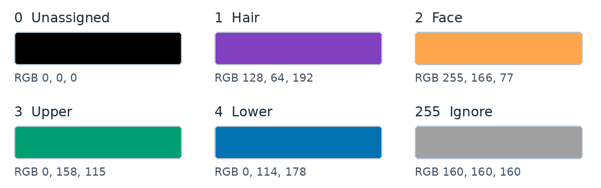

# CCTV Human Parsing 600 Dataset

**Person Detection and Four-Part Human Parsing**

ชุดข้อมูลภาพ CCTV จำนวน **600 ภาพ** พร้อมกรอบบุคคลและ annotation สี่ส่วน ได้แก่ **Hair, Face, Upper และ Lower** แต่ละส่วนเชื่อมกับบุคคลในภาพด้วย person ID เพื่อรองรับทั้งการประเมินตำแหน่งคนและการแยกส่วนรายบุคคล

ชื่อ repository สำหรับเอกสารส่งมอบคือ [CCTV-Human-Parsing-600-Dataset](https://github.com/folklazy/CCTV-Human-Parsing-600-Dataset) ส่วนรหัสชุดข้อมูลใน release metadata คือ `CCTV-Human-Parsing-600` เพื่ออ้างถึงสมาชิกและ annotation ของรุ่นที่กำหนด

เอกสารชุดนี้อธิบายข้อมูลรุ่น **1.0.1-rc.1** ซึ่งบันทึก annotation ที่ผู้จัดทำแก้เพิ่มเติม และตรวจไฟล์ครบ 600 ภาพเมื่อ **17 พฤศจิกายน 2026 เวลา 13:41 น. Asia/Bangkok** ข้อกำหนดคลาสยังใช้ ontology รุ่น 1.0.0 รุ่นปัจจุบันผ่านการตรวจไฟล์และโครงสร้าง ผู้จัดทำตรวจและยืนยันรูปทรงซ้อนในสามกรณีที่แจ้งเพิ่มแล้ว โดยอธิบายว่าเกิดจากมุมกล้องกดลงและแนวผมกับเสื้อที่ซ้อนกันในภาพ ข้อจำกัดของการแปลงรูปทรงเหล่านี้ไปวัดคะแนนอยู่ใน [ผลตรวจคุณภาพ](#6-ผลตรวจคุณภาพ)

## ข้อมูลโดยสรุป

| รายการ | รายละเอียด |
| --- | --- |
| ชื่อชุดข้อมูล | CCTV Human Parsing 600 Dataset |
| รหัสชุดข้อมูลสำหรับ release และ bindings | `CCTV-Human-Parsing-600` |
| รุ่นข้อมูลปัจจุบัน | 1.0.1-rc.1 |
| รุ่นนิยามคลาสและ schema | 1.0.0 |
| จำนวนภาพ | 600 ภาพ |
| งานหลัก | Person bounding-box detection และ four-part human parsing |
| คำตอบอ้างอิง | Visible-person bbox, image-local person ID, part shapes และ ignore regions |
| คลาสเป้าหมาย | Hair, Face, Upper, Lower |
| เกณฑ์ขนาดบุคคล | ด้านยาวของ visible bbox ตั้งแต่ 50 px บนภาพต้นฉบับ |
| รูปแบบ annotation | X-AnyLabeling JSON ในพิกัดภาพต้นฉบับ |
| จำนวนกรอบบุคคล | 774 รายการ |
| จำนวน part shapes | 2,449 รายการ |
| จำนวน ignore shapes | 172 รายการ |
| สถานะ | ตรวจไฟล์และโครงสร้างผ่าน 600/600 ภาพ ผู้จัดทำยืนยันรูปทรงซ้อนสามกรณี พร้อมข้อจำกัดของ evaluation export |

อ่าน [ข้อกำหนด annotation](ANNOTATION_SPEC.md) สำหรับนิยามขอบเขตแต่ละคลาสและวิธีอ่านข้อมูล ตารางรหัสที่โปรแกรมอ่านได้อยู่ใน [labels.json](schema/labels.json) และโครงสร้าง JSON อยู่ใน [annotation.schema.json](schema/annotation.schema.json)

## 1. วัตถุประสงค์

ชุดข้อมูลนี้จัดทำเพื่อศึกษาการตรวจจับบุคคลและการแยกผม ใบหน้า เสื้อผ้าส่วนบน และเสื้อผ้าส่วนล่างในภาพจากกล้อง CCTV การเชื่อม part กับเจ้าของช่วยแยกข้อผิดพลาดเรื่องชนิดส่วนออกจากข้อผิดพลาดที่นำส่วนของคนข้างเคียงมารวมกับบุคคลที่กำลังประเมิน

งาน instance-level human parsing มีทั้งการระบุชนิดส่วนในแต่ละพิกเซลและการจัดส่วนเหล่านั้นให้กับบุคคล การออกแบบข้อมูลจึงเก็บ class label และ person ID แยกกัน [Gong et al., CIHP/PGN, ECCV 2018](https://arxiv.org/abs/1808.00157v1)

## 2. องค์ประกอบของข้อมูล

| คุณลักษณะ | จำนวนหรือช่วง |
| --- | --- |
| ความกว้างภาพ | 1,280–2,688 px |
| ความสูงภาพ | 720–1,520 px |
| รหัสสถานที่ที่มีชื่อ | 8 ค่า |
| ภาพที่สถานที่เป็น Unknown | 2 ภาพ |
| คู่ค่า site/camera_name | 67 คู่ รวมข้อมูลที่ site เป็น Unknown |
| กลางวัน / กลางคืนตาม metadata | 243 / 357 ภาพ |
| ภาพที่มี person bbox | 540 ภาพ |
| ภาพที่ไม่มี person bbox ใน annotation | 60 ภาพ |

การนับสถานที่และกล้องอ้างค่าที่บันทึกใน metadata ส่วนการแบ่งกลางวันกับกลางคืนยังไม่มีการตรวจยืนยันสภาพแสงรายภาพครบชุด ภาพที่ไม่มี bbox ต้องพิจารณาความครบถ้วนของ person inventory ก่อนใช้เป็นภาพลบในการประเมิน detector

### จำนวน annotation รายคลาส

| คลาส | จำนวน shapes | จำนวนคู่ภาพ–บุคคลที่มีคลาสนี้ | จำนวนภาพที่มีคลาสนี้ |
| --- | --- | --- | --- |
| Hair | 550 | 545 | 435 |
| Face | 393 | 391 | 327 |
| Upper | 799 | 746 | 532 |
| Lower | 707 | 664 | 482 |

Shape หมายถึงบริเวณที่วาดหนึ่งชิ้น บุคคลเดียวอาจมีหลาย shapes ในคลาสเดียว เช่น เสื้อที่เห็นสองด้านของสิ่งกีดขวาง จำนวนคู่ภาพ–บุคคลใช้ `(image_id, person_id)` เป็นหน่วยนับ การปรากฏของคนในคนละภาพจึงนับแยกกัน ตารางนี้นับจาก source shapes ก่อนใช้เกณฑ์ 50 px และก่อนจัดการ ignore/conflicts จำนวนส่วนที่เข้า denominator ของ scorer ต้องคำนวณจาก export ของการทดลองนั้น

### ขนาดบุคคล

| ด้านยาว visible bbox | จำนวนกรอบ |
| --- | --- |
| ต่ำกว่า 50 px | 5 |
| ตั้งแต่ 50 ถึงต่ำกว่า 100 px | 178 |
| ตั้งแต่ 100 ถึงต่ำกว่า 200 px | 342 |
| ตั้งแต่ 200 px | 249 |

มี 769 กรอบผ่านเกณฑ์ขนาดของงานหลัก อีก 5 กรอบเก็บไว้พร้อมสถานะยกเว้น ขนาดนี้วัดในภาพต้นฉบับ การแปลงเป็นระยะทางจริงต้องมีข้อมูลกล้องและการสอบเทียบเพิ่มเติม

## 3. รหัสป้ายกำกับ



| Label ID | ชื่อใน JSON | ความหมาย | RGB สำหรับแสดงผล |
| --- | --- | --- | --- |
| 0 | ไม่มี shape โดยตรง | Unassigned พื้นที่ที่ยังไม่มี target label กำกับ | 0, 0, 0 |
| 1 | `hair` | ผมศีรษะที่มองเห็น | 128, 64, 192 |
| 2 | `face` | ใบหน้าที่มองเห็นตามนิยามในคู่มือ | 255, 166, 77 |
| 3 | `upper` | เสื้อผ้าส่วนบนที่มองเห็น | 0, 158, 115 |
| 4 | `lower` | เสื้อผ้าส่วนล่างที่มองเห็น | 0, 114, 178 |
| 255 | `ignore` | พื้นที่ที่ระบุให้ยกเว้น | 160, 160, 160 |

Annotation ต้นฉบับใช้ข้อความใน `label` ตารางตัวเลขนี้กำหนดสำหรับการอ่านและแลกเปลี่ยนข้อมูลของรุ่น 1.0.0 การอ่านเป็นตัวเลขอาศัย mapping ใน `labels.json` และคง JSON ต้นฉบับไว้

RGB ในตารางใช้ระบาย annotation ให้เห็นชนิดคลาส ส่วนคำตอบสีเสื้อผ้าต้องอ่านจากภาพต้นฉบับและจัดเก็บแยกตามงานสกัดสี

`bbox` มี detection category ชื่อ `person` และ `category_id=1` ใน namespace ของงาน detection ส่วน `group_id` ใช้บอกเจ้าของภายในภาพ ตัวอย่างเช่น `label_id=1` หมายถึง Hair แต่ `group_id=1` หมายถึงบุคคลหมายเลข 1 ของภาพนั้น

รหัส 0 ครอบคลุมพื้นที่ที่อยู่นอก part shapes ซึ่งอาจเป็นฉากหลัง ส่วนอื่นของคน หรือบริเวณที่ยังไม่มีคำตอบ การใช้พื้นที่เหล่านี้เป็น negative ต้องมี valid-domain ที่กำหนดไว้ก่อน การแยก dataset ID ออกจาก train ID ช่วยให้การแปลงข้อมูลสำหรับโมเดลตรวจย้อนกลับได้ แนวทางนี้พบในตาราง labels ของ Cityscapes ซึ่งประกาศ ID, train ID และ ignore status แยกกัน [Cityscapes label definitions](https://github.com/mcordts/cityscapesScripts/blob/9f0aa8d3fa937c42bd5f21e0180a6546f077539f/cityscapesscripts/helpers/labels.py)

## 4. วิธีจัดทำ annotation

การจัดทำใช้ model-assisted annotation เครื่องมือช่วยร่างประกอบด้วย SAM3.1 สำหรับข้อเสนอบุคคลและ segmentation และ SOLIDER Swin-Small ที่ปรับให้เหมาะกับงานสี่ส่วน ผู้ใช้ตรวจภาพต้นฉบับและแก้ bbox ขอบเขต คลาส และเจ้าของใน X-AnyLabeling การสร้างร่างแต่ละภาพมี provenance กำกับ ส่วน GT ใช้นิยามคลาสและเจ้าของร่วมกันตามข้อกำหนดชุดข้อมูล

เส้นทาง SOLIDER รับ RGB crop ของบุคคลพร้อมบริบทรอบกรอบ 15% ทำ aspect-preserving letterbox กว้าง 384 × สูง 576 ก่อนใช้ preprocessing ของโมเดลที่ input สูง 572 × กว้าง 384 โดย inference ใช้ FP32 และ batch 1 เก็บผลทำนายก่อนและหลังใช้ person mask ช่วยจัดเจ้าของ เพื่อให้ตรวจส่วนที่ mask อาจตัดออกได้

ในขั้นคัดร่างมีเกณฑ์คะแนน proposal และเกณฑ์ near-duplicate เพื่อจัดภาระงานตรวจ เกณฑ์เหล่านี้เป็นค่าของ helper การรับรอง GT อ้างการตรวจแก้โดยผู้ใช้และรายการไฟล์ที่ผูก hashes ส่วนคะแนนจากโมเดลและ flags ของเครื่องมือเก็บเป็นข้อมูลประกอบ ความแม่นยำของการทำร่างกับคุณภาพ annotation หลังคนแก้จึงต้องวัดแยกกัน

แนวทางการใช้ concept prompts อ้าง SAM3 ส่วน human-centric representation อ้าง SOLIDER การนำมาใช้ช่วยร่างในชุดนี้ยังต้องอาศัยการตรวจแก้จากภาพจริง [SAM3 paper v2](https://arxiv.org/abs/2511.16719v2), [SOLIDER paper v1](https://arxiv.org/abs/2303.17602v1)

ผู้จัดทำยืนยันการตรวจแก้ 600 ภาพในรุ่น 1.0.0 และแก้ annotation เพิ่มเติม 23 ไฟล์ในรุ่นปัจจุบัน การตรวจด้วยโปรแกรมครอบคลุมทั้งชุด ส่วนการเปิดดูรอบนี้ครอบคลุม 23 ภาพที่ไฟล์เปลี่ยนและอีก 3 ภาพที่มี interior overlap สูงสุด รวม 26 ภาพที่ไม่ซ้ำกัน เลือกตามการเปลี่ยนไฟล์และความกำกวมของ annotation ยังไม่มีการวัด agreement ระหว่างผู้ทำ annotation หลายคนหรือเวลาที่ใช้แก้จริง แนวทาง COCO แยกขั้น instance spotting, segmentation และ verification ซึ่งใช้ประกอบการอธิบายหน้าที่แต่ละขั้นในงานนี้ [Lin et al., Microsoft COCO, ECCV 2014](https://arxiv.org/html/1405.0312v3)

## 5. รูปแบบส่งมอบ

ไฟล์ภาพและ annotation จริงจัดเก็บในพื้นที่ข้อมูลที่ควบคุมการเข้าถึง Repository นี้เก็บเอกสาร schema ตาราง IDs ตัวอย่างสังเคราะห์ และสถิติรวม

```text
CCTV_Human_Parsing_600/
├── README.md
├── ANNOTATION_SPEC.md
├── DATASET.json
├── assets/
│   └── label-palette.png
├── schema/
│   ├── labels.json
│   └── annotation.schema.json
└── examples/
    └── annotation.json
```

รายการข้อมูลจริงมีหนึ่งแถวต่อภาพ ระบุ `image_id`, ตำแหน่งภาพและ annotation, ขนาดภาพ, SHA256 ของไฟล์ทั้งสอง และข้อมูลอ้างอิงที่จำเป็น ผู้รับข้อมูลควรใช้ manifest ของ revision ที่เลือก เพราะ `imagePath` ภายใน JSON เป็นชื่อไฟล์ที่โปรแกรม annotation บันทึกไว้ รุ่นปัจจุบันมี snapshot ของ JSON ทั้ง 600 ไฟล์แยกจากไฟล์ที่เปิดแก้ และมี `CURRENT.json` ในพื้นที่ข้อมูล private ชี้ไปยัง manifest ของ snapshot นั้น

ตัวอย่างใน `examples/annotation.json` ใช้พิกัดสมมติสำหรับอธิบายโครงสร้าง สรุปจำนวนและ fingerprint ของชุดส่งมอบอยู่ใน [DATASET.json](DATASET.json)

## 6. ผลตรวจคุณภาพ

ตรวจ membership, hashes, image decoding, ขนาดภาพ, JSON Schema, class vocabulary และการเชื่อม part กับ bbox ครบทั้งชุด ผลการอ่านไฟล์และโครงสร้างหลักผ่าน 600/600 ภาพ กรอบและ owner IDs ของ bbox ตรงกับ snapshot ก่อนแก้ครบ 600 ภาพ และทุก part มี bbox เจ้าของ ผลตรวจภาพซ้ำแบบ byte-identical และ decoded RGB-identical จากรุ่นก่อนยังใช้ได้ เพราะ image hashes คงเดิมทั้ง 600 ภาพ

### ผลของการแก้ annotation

| รายการ | รุ่น 1.0.0 | รุ่น 1.0.1-rc.1 |
| --- | --- | --- |
| ภาพ | 600 | 600 |
| Person bboxes | 774 | 774 |
| Part shapes รวม | 2,471 | 2,449 |
| Part shapes พื้นที่เชิงเรขาคณิตศูนย์ | 5 | 0 |
| Ignore shapes | 172 | 172 |
| ไฟล์ annotation ที่เปลี่ยนจากรุ่น 1.0.0 | — | 23 |

รายการซ้ำขนาดเล็กและส่วนเดี่ยวที่ผู้จัดทำแจ้งถูกตรวจเทียบกับไฟล์ปัจจุบันแล้ว หลายชิ้นถูกนำออก กรณีที่เคยพบ Lower บริเวณศีรษะถูกตรวจตำแหน่งเดิมอีกครั้งและไม่พบป้าย Lower ที่ตำแหน่งนั้น การไม่มี shape หลังแก้ยังต้องตีความตามข้อกำหนดส่วนที่ไม่มี annotation จึงต้องสร้าง eligibility และ denominator ใหม่เมื่อประเมินผล

| ข้อสังเกตที่บันทึกไว้ | จำนวน |
| --- | --- |
| Part shapes ที่มีพื้นที่เชิงเรขาคณิตศูนย์ | 0 shapes |
| Shapes มีพิกัดเกินขอบภาพเล็กน้อย | 4 shapes |
| Ignore shape มี person ID ค้าง | 1 shape |
| ต่างคลาสซ้อนพิกเซลหลัง rasterize | 7,893 px ใน 181 ภาพ |
| ต่างคลาสยังซ้อนหลัง erode แต่ละคลาส 1 px | 3,888 px ใน 17 ภาพ |
| Part foreground มีหลายเจ้าของในพิกเซลเดียวกัน | 91 px ใน 8 ภาพ |
| Ignore ซ้อน target | 107 px ใน 2 ภาพ |
| ตัวอย่าง Hair/Upper ทับกันมากที่ผู้จัดทำตรวจและยืนยันแล้ว | 3 ภาพ |

ตัวเลข overlap ใช้ PIL ImageDraw วาด polygon/rectangle แบบ inclusive บน original grid โดยรวม shapes ภายในคลาสเดียวกันด้วย union การ erode ใช้ kernel 3×3 หนึ่งครั้ง ตัวเลขนี้ขึ้นกับ rasterizer และใช้บอกตำแหน่งที่ต้องจัดการเมื่อสร้าง evaluation export

พื้นที่ซ้อนหลัง erode จำนวน 3,888 px กระจุกอยู่ในสามภาพหลัก 3,686 px หรือประมาณ 94.8% ผู้จัดทำตรวจทั้งสามกรณีและยืนยันให้เก็บรูปทรงตาม source โดยอธิบายว่าเป็นลักษณะจากกล้องมุมกดลง วันที่ 17 พฤศจิกายน 2026 รายการนี้มีสถานะ **ผู้จัดทำตรวจแล้วและยอมรับรูปทรงซ้อน** เหตุผลด้านมุมกล้องเป็นคำอธิบายจากผู้จัดทำ ส่วนค่าพื้นที่ซ้อนเป็นผลตรวจบนพิกัดภาพสองมิติ รายการภาพและภาพประกอบเก็บในพื้นที่ private

ผลตรวจ export ด้วยกติกา shared-reference เดิมพบว่า overlap ระหว่างคลาสถูกตัดออกจาก valid domain ร่วม ตัวอย่างหนึ่งมี Hair 1,552 px ซ้อน Upper ทั้งหมด จึงเหลือ Hair ที่ใช้วัด 0 px และหลุดจาก positive-part denominator อีกตัวอย่างมี Hair 1,563 px เหลือใช้วัด 41 px การใช้ source รูปทรงซ้อนจึงต้องรายงาน support ก่อนและหลัง export รวมถึงจำนวนส่วนที่หลุดจากตัวหาร คะแนนจาก domain นี้อธิบายเฉพาะพื้นที่ที่ยังมีคำตอบคลาสเดียวตามกติกา export

รอบนี้อ่านข้อมูลและสร้าง snapshot พร้อมหลักฐานตรวจ โดยมี model calls เท่ากับ 0 การรับรองความถูกต้องเชิงความหมายยังมีขอบเขตตาม 26 ภาพที่เปิดดู ยังไม่มีการตรวจ polygon self-intersection หรือการตัดสินขอบเขตทุกส่วนด้วยผู้ตรวจอิสระครบ 600 ภาพ รหัส `1.0.1-rc.1` อ้าง snapshot ของไฟล์ที่ตรวจครั้งนี้ คำยืนยันรูปทรงซ้อนบันทึกเพิ่มในประวัติการตรวจของ snapshot เดียวกัน

## 7. เงื่อนไขการนำไปใช้

### ขอบเขต coverage ที่ตรวจได้

| ปัจจัย | หลักฐานในชุดข้อมูล |
| --- | --- |
| ขนาดคน | มี bbox และการกระจายขนาดตามตารางข้างต้น |
| กลางวัน/กลางคืน | มี metadata 243/357 ภาพ ยังไม่มี human-verified illumination tags ครบชุด |
| ความต่างของกล้อง | มีคู่รหัส site/camera 67 คู่ มุมก้ม/เงยและระยะทางจริงยังไม่มี annotation เชิงเรขาคณิต |
| การบดบังและท่าทาง | ยังไม่มีสถานะรายคนครบสำหรับสรุปสัดส่วน coverage |
| ภาพเบลอ แสงย้อน และแสงน้อย | ยังไม่มีระดับความรุนแรงที่ตรวจโดยคนครบทุกภาพ |

การมีภาพหลายกล้องช่วยเพิ่มความหลากหลายของข้อมูล ส่วนการอ้างความสมดุลของระดับความยากต้องมี tags และจำนวนที่ตรวจได้เพิ่มเติม

### งานประเมินที่รองรับ

ข้อมูลรองรับการศึกษากรอบบุคคลและ masks สี่ส่วนพร้อมเจ้าของ โดยต้องระบุ valid domain, การจับคู่คน และวิธีจัดการพื้นที่กำกวมก่อนคำนวณคะแนน รายละเอียดวิธีนับ TP/FP/FN และตัวชี้วัดอยู่ใน [ข้อกำหนดการประเมิน](ANNOTATION_SPEC.md#8-การนำไปประเมินผล)

ขอบเขตคำตอบที่มีอยู่จำกัดการใช้งานบางด้านดังนี้

- Full-person mask IoU/AP ต้องมี GT mask รูปร่างคนเต็มตัวเพิ่มเติม
- การวัดสีเสื้อผ้าต้องมี GT สี ซึ่งรุ่นนี้ยังไม่มีครบชุด
- สถานะ absent, unobservable และ not-annotated รายส่วนยังไม่มีฟิลด์ครบเพื่อแยกทุกกรณี
- กลุ่มเสื้อผ้าชิ้นเดียวที่คร่อมบน–ล่างยังไม่มี structured tag ครบสำหรับรับรองขอบเขตทุกภาพ
- การติดตามและ Re-ID ต้องมี identity ข้ามภาพเพิ่มเติม

รุ่นนี้ประกาศสมาชิก 600 ภาพหนึ่งชุด การแบ่ง train/validation/test สำหรับผู้ใช้ปลายทางยังไม่ได้จัดทำแยกใน repository นี้ ข้อมูลบางส่วนมีประวัติใช้พัฒนาและเลือกโมเดลช่วยร่าง ผู้ดูแลเก็บ exposure records ไว้ประกอบการแบ่งข้อมูล การรายงานผลบนข้อมูลที่ใช้พัฒนาแล้วต้องระบุสถานะ development evaluation ให้ชัด

## 8. การเข้าถึงและการดูแลข้อมูล

เอกสารและ schema เผยแพร่ผ่าน GitHub ส่วนภาพ annotation รายภาพ และ metadata ที่ระบุแหล่งข้อมูลเก็บในพื้นที่ private เงื่อนไขการส่งต่อภาพจริงให้ยึดสิทธิ์ของเจ้าของข้อมูลและข้อตกลงที่มีอยู่ Repository นี้ยังไม่มีใบอนุญาตสาธารณะสำหรับภาพจริง

การแก้ annotation ให้บันทึก revision, เหตุผล และ old/new hashes เพื่อให้ผลทดลองแต่ละรอบอ้างชุดคำตอบที่ตรงกัน การเปลี่ยนรหัสคลาสหรือความหมายคลาสต้องเพิ่มรุ่น ontology และระบุ mapping ที่ใช้แปลงข้อมูล ขั้นตอนแก้และรับเข้า snapshot อยู่ใน [ข้อกำหนด annotation ข้อ 7.1](ANNOTATION_SPEC.md#71-การตรวจแก้และบันทึก-revision)

รุ่นปัจจุบันมี membership SHA256 เป็น `4fc98058ecf33e33b9116cef938958860545be4e6d05b06dc87d49a64aaf4126` รุ่นก่อนมีค่า `d9a5cdc80d3b1f462125776e02c2ef1e87be1b881bdd3482e81d72fdaf25d6fc` ผลคะแนนที่อ้าง hash รุ่นก่อนต้องคง reference เดิมไว้ การใช้ GT รุ่นใหม่ต้องจับคู่และคำนวณคะแนนใหม่จาก saved predictions ที่ตรวจ bindings ผ่าน การใช้ผล inference เดิมขึ้นกับ input/checkpoint/config/route ที่ตรงกัน

เอกสารรุ่น 1.0.0 และสถิติเดิมอ่านได้จากประวัติ Git [Snapshot รุ่นก่อน](https://github.com/folklazy/CCTV-Human-Parsing-600-Dataset/tree/d77ad2eec84e3e44b1465abd17031c8f57e1f18f)

หากอ้างอิงชุดนี้ ให้ระบุชื่อ **CCTV Human Parsing 600 Dataset**, dataset revision, ontology version, membership SHA256 และ commit ของ repository ที่ใช้งาน ปัจจุบันยังไม่มี DOI หรือบทความเผยแพร่ของชุดข้อมูลนี้

โครงสร้างเอกสารครอบคลุมที่มา องค์ประกอบ การจัดทำ ขอบเขตการใช้ การเผยแพร่ และการดูแลตามหัวข้อใน Datasheets for Datasets [Gebru et al., 2021](https://arxiv.org/html/1803.09010v8)
